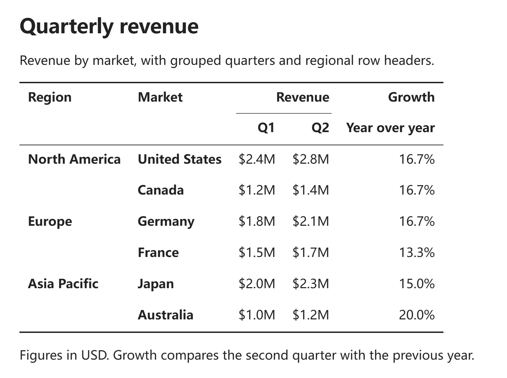
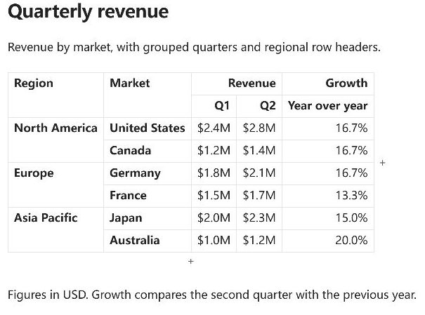
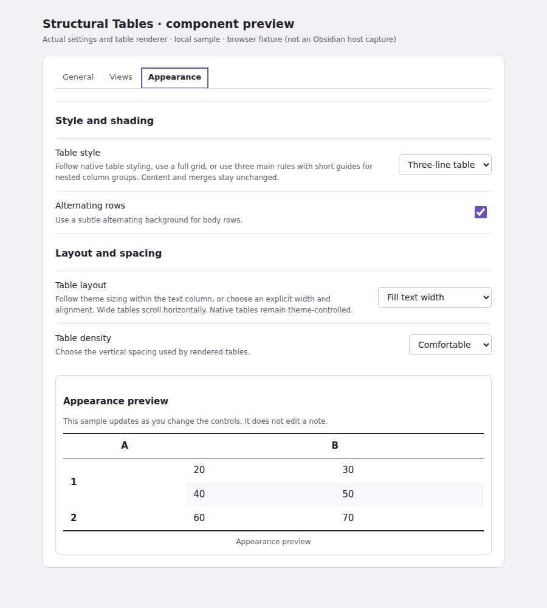

# Structural Tables

[English](../../README.md) · [简体中文](README.zh-CN.md) · [繁體中文](README.zh-TW.md) · [日本語](README.ja.md) · [한국어](README.ko.md) · [Deutsch](README.de.md) · [Français](README.fr.md) · [Español](README.es.md) · [Português (Brasil)](README.pt-BR.md) · [Русский](README.ru.md) · [Tiếng Việt](README.vi.md) · [العربية](README.ar.md)

このページでは、よく使う操作と注意点を紹介します。詳しい手順は [英語版](../../README.md) と [簡体字中国語版](README.zh-CN.md) にあります。

Markdown の表でセルの結合、複数行の列見出し、行見出し、見出しのない表を使えます。表を開いたり表示したりするだけでノートの Markdown が書き換わることはありません。

## スクリーンショット

### 閲覧ビューの三線表

複数行の見出しと結合セルを表示し、すべてのセルに枠線を引かずにグループを区切ります。



### ライブプレビューで編集

デスクトップではセルをクリック、タッチ画面ではダブルタップして内容を編集できます。



### 外観設定



外観設定の画像は実際の設定・表コンポーネントをブラウザーで表示した例で、Obsidian 本体のスクリーンショットではありません。

<!-- section: features -->
## 機能

- 新規の表には GFM 互換の `<<`・`^^` を既定で使用します。従来の簡潔な構文も選べます。

- `<` は Markdown のソース順で一つ前の列と結合し、`^` は上のセルと結合します。RTL 表示では前の列が画面右側になる場合もあります。
- 区切り行の連続した `||` で行見出しの列を指定します。列見出しは複数行にできます。
- 閲覧ビューとライブプレビューの両方で結合構造を表示します。
- 行と列の追加・移動・削除、表全体の転置に対応します。
- HTML、通常の GFM、TSV、CSV にコピーできます。デスクトップでは PNG に出力できます。
- ブラウザーや表計算ソフトの対応 HTML 表を貼り付けられます。
- プレビューを確認して Obsidian Base に変換できます。
- 選択外の内容が失われる操作は拒否します。ただし明示的なクリア・削除は実行できます。

<!-- section: requirements-and-compatibility -->
## 必要環境と互換性

Obsidian 1.12.7 以降が必要です。デスクトップ版と Android に対応します。Base への変換には標準プラグイン Bases を有効にしてください。

`<`、`^`、`||` は独自構文です。他の Markdown エディターでは結合状態が正しく表示されない場合があります。Advanced Tables などの操作を使う際は「テーブルのソースを編集」を開き、並べ替え後に内容を確認してください。

### 表の互換性についてのお詫びと説明

**2026-10-31**

このプラグインは、Obsidian で論文の複雑な表を扱うために私が考え、AI の助けを借りて実装した小さなツールです。必要だったのは LaTeX のごく一部の機能だったので、少しだけ Markdown を拡張して代用しました。当初は自分の用途を優先し、ほかの Markdown エディターとの互換性に十分配慮できていませんでした。

従来の列見出しなし・行見出しの構文は GFM の表構造に沿っておらず、一部のエディターでは表として正しく認識・表示されません。設計時の見落としです。閲覧、共有、移行でご不便をおかけしたことをお詫びします。

新たに、従来の簡潔な構文に加えて GFM 互換構文を選べるようにしました。`<<` の列より前を行見出し、`^^` の行より上を列見出しとし、先頭行が `^^` なら列見出しなしです。ほかの GFM 対応エディターでも通常の表として読み取れますが、矢印はセルの文字として表示されます。

<!-- section: installation -->
## インストール

Obsidian の「設定 → コミュニティプラグイン → 閲覧」で Structural Tables を検索し、インストールして有効にします。

手動の場合は `structural-tables-<version>.zip` を `Vault/.obsidian/plugins/` に展開し、Obsidian を再読み込みして有効にします。

[GitHub Releases](https://github.com/ZHYX91/obsidian-structural-tables/releases/latest).

<!-- section: usage -->
## 使い方

空行にカーソルを置き、文字を選択していない状態でコマンドパレットから**構造化テーブルを挿入**を実行すると、サンプルが挿入されます。ライブプレビューでカーソルを表の外へ移すか、閲覧ビューに切り替えて表示を確認してください。次の例も同じ構造です。内容を変更して使えます。

```markdown
| 地域 | << | 売上 | < |
| --- | --- | --- | --- |
| 四半期 | << | Q1 | Q2 |
| ^^ | << | ^^ | ^^ |
| 北部 | << | 10 | 12 |
| ^ | << | 8 | 11 |
```

新規の表は GFM 互換構文を既定で使います。`<<` の列より前のソース列が行見出し、`^^` の行より上が列見出しです。プラグインではこの制御行・制御列を表示しません。

列見出しが不要なら、先頭行の各セルを `^^` とします（`<<` 列との交点は `<<` のまま）。2 行目には通常の GFM の `---` 区切り行を置きます。

従来の `||` を使う簡潔な構文も残ります。コマンドで構文を変換するときは、ソースのプレビューを確認してから置き換えます。これは構造を展開する「標準 GFM に変換」とは別です。設定は新規作成と取り込みだけに適用されます。

従来の簡潔な構文：

```markdown
| 地域 | 売上 | < |
| 四半期 | Q1 | Q2 |
| --- || --- | --- |
| 北部 | 10 | 12 |
| ^ | 8 | 11 |
```

列見出しのない表：

```markdown
| ^^ | ^^ |
| --- | ---: |
| A | 10 |
| B | 20 |
```

表示がおかしいときは、コマンドパレットから**現在のノートの構造化テーブルを検証**を実行してください。問題を報告するだけで、Markdown は変更しません。

ライブプレビューでセルをクリックして編集します。Enter で保存して移動、Shift+Enter で改行、Escape でキャンセルします。行・列のハンドルをドラッグして移動できます。

グリッド選択中の Delete/Backspace はセルの文字だけを消し、結合や見出し構造は維持します。行・列・表を削除するには右クリックメニューを使い、Undo で戻せます。

セル範囲をコピー・切り取りできます。貼り付け先には、結合構造が一致する長方形の範囲、または左上の起点となる未結合のセルを1つ選びます。1セルを起点にする場合は、表を右と下に拡張できます。既存の結合セルの一部だけを上書きすることはできません。モバイルでクリップボードを変更したりプラグインを再読み込みしたりすると、以前の結合情報は使えません。

デスクトップでは表全体の PNG をプレビュー、コピー、保存できます。未保存のセル編集は画像に入りません。モバイルでは画像出力できません。

Base に変換する前にノートを保存し、引用やリスト内の表はトップレベルへ移動してください。結合情報は展開され、表を復元しても生成済みの記録ノートは残ります。

データ部分に結合セルがある場合は、Base に変換する前に分割する必要があります。変換後は Base ブロック内にカーソルを置き、**現在の Base にレコードを作成**を実行すると、空のレコードを追加できます。

### 通常の Markdown 表

通常の GFM 表は標準では Obsidian の表エディターを使います。「通常の Markdown テーブルにも適用」を有効にした場合だけ本プラグインの操作が使えます。ヘッダーより列数が多い行には非表示のソースセルが残るため、まず「テーブルのソースを編集」で修正してください。

### 数式と改行

Shift+Enter で見た目の改行を入れられ、対応する `<br>` として保存されます。数式中の未エスケープの `|` は表の区切りと区別できない場合があります。この場合は編集内容を保持して保存を拒否します。意味に応じて TeX の `\lvert`、`\rvert`、`\mid` を使用してください。

### 貼り付けとコピー

HTML の貼り付けはセル構造を安全に保てる場合にだけ変換します。保存できない書式がある場合は完全なプレーンテキストを使うか、Obsidian の標準貼り付けに任せます。プレーンテキストでは結合や装飾は残りません。通常 GFM への変換後は対象エディターで表を確認してください。

### 標準 GFM に変換

表を右クリックして「通常の GFM テーブルに変換…」を選びます。編集ビューでは表のソース内にカーソルを置き、通常の GFM に変換するコマンドからも開けます。

行見出ししかない表では、行と列を入れ替えて先頭の見出し行にすることを推奨します。列見出しがない表で元の向きを維持すると、先頭に空の見出し行を追加し、既存のデータ行をすべて保持します。

結合セルは個別のセルに分かれ、結合範囲の各位置に同じ内容が入ります。複数の見出し行は1行になり、各階層の見出しは「 / 」でつながれます。側面に残る行見出しは通常のセルになります。GFM ではその行見出しの役割を保持できません。

結果のプレビューと Markdown ソースを切り替え、現在の結果をコピーするか元の表を置換できます。閲覧ビューではコピーのみ可能です。置換は1回の変更として記録され、1回の取り消しで元に戻ります。閉じるだけではソースは変わりません。セルの編集を終えてから操作し、元の表やファイルが変わった場合はプレビューを開き直してください。通常の GFM を直接コピーするコマンドは推奨の向きを使います。

### 画像と Base の復元

PNG は一辺 8192 ピクセル、合計 1600 万ピクセルが上限です。全体を収められない場合は切り取った画像を作らず停止します。Base への変換時にはレコードノートと `_promotion.json` の復元情報を作成します。表の復元で後からの Base の編集内容は取り込まず、作成済みのノートも削除しません。

<!-- section: settings -->
## 設定

「一般」：言語、HTML 貼り付け、競合通知。「表示」：閲覧、ライブプレビュー、診断、通常 GFM の編集。「外観」：表のスタイル、幅、余白、交互の行背景。

テーマに従う、グリッド、三線表から選択できます。外観やインターフェース言語を変えても Markdown の内容や表の方向は変わりません。

「罫線と背景」と「配置と余白」の下に、変更がすぐ反映されるサンプルを表示します。サンプルは固定の文字だけを使い、ノートを読み込んだり編集したりしません。設定は Vault 全体の表に適用され、自動保存されます。

**新規表の構文**は既定で GFM 互換です。簡潔な構文への切り替えは新規作成と取り込みのみに適用され、既存のノートは書き換えません。

<!-- section: limitations -->
## 制限

表計算エンジンではなく、数式を計算しません。セルごとの装飾、キャプション、ブロック Markdown、ソース行をまたぐ本当の改行には対応しません。

HTML はプレーンテキストと対応する `<br>` に変換します。通常の GFM ではすべての結合を表現できず、Base 変換では見出し構造が平坦化されます。

<!-- section: privacy-and-security -->
## プライバシーと安全性

表の処理はローカルで行われ、内容のアップロードや解析データの収集はありません。表示するだけでは Markdown を変更しません。

リモート画像やフォントの通信は Obsidian とテーマの設定に従います。非公開のノートやパスを公開の issue に貼らないでください。

<!-- section: development -->
## 開発

Node 24.19.0、npm 11.17.0 を使用します。依存関係をインストールしてチェックを実行してください。

```bash
npm ci
npm run check
```

[Architecture](https://github.com/ZHYX91/obsidian-structural-tables/blob/main/docs/architecture.en.md) · [Contributing](https://github.com/ZHYX91/obsidian-structural-tables/blob/main/CONTRIBUTING.md) · [Changelog](https://github.com/ZHYX91/obsidian-structural-tables/blob/main/CHANGELOG.md)

<!-- section: support -->
## サポート

使い方は Q&A、アイデアは Ideas、再現できる問題は GitHub Issues に投稿してください。Obsidian のバージョン、テーマ、表の Markdown、期待する結果と実際の結果を添えてください。

[Q&A](https://github.com/ZHYX91/obsidian-structural-tables/discussions/categories/q-a) · [Ideas](https://github.com/ZHYX91/obsidian-structural-tables/discussions/categories/ideas) · [GitHub Issues](https://github.com/ZHYX91/obsidian-structural-tables/issues/new/choose) · [Private security reporting](https://github.com/ZHYX91/obsidian-structural-tables/security/advisories/new)

脆弱性は公開せず、非公開のセキュリティ報告を利用してください。

<!-- section: license -->
## ライセンス

[MIT](https://github.com/ZHYX91/obsidian-structural-tables/blob/main/LICENSE) © ZhengYX
